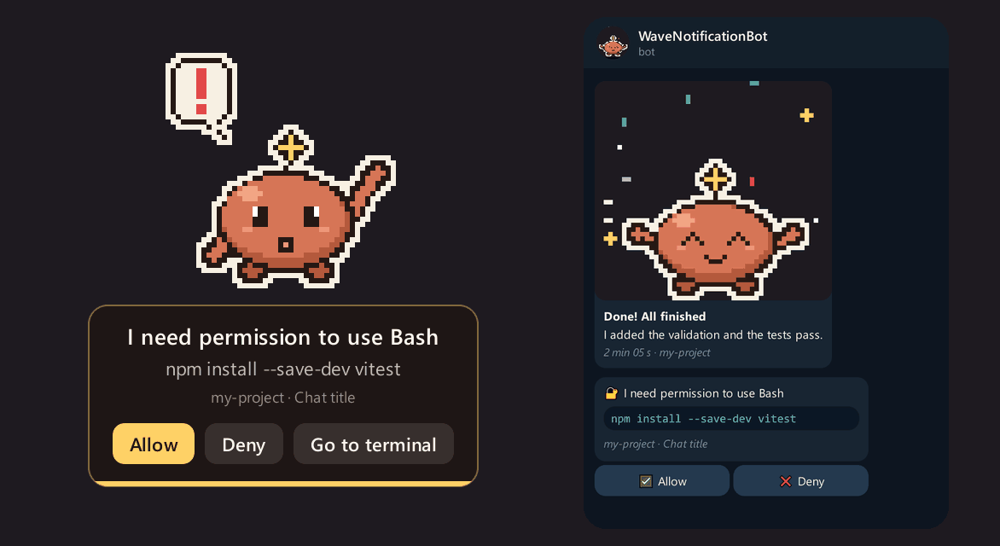

<h1 align="center">Francisco Maresca</h1>
<h3 align="center">Data Analyst · Python Developer · Physics & Data Science Student @ UBA</h3>

  
  
  
  

---

## 🚀 Latest launch — WaveMascot

  

**[Wave](https://github.com/Marescaa/wavemascot)** is a pixel-art desktop mascot for **Windows and macOS** that tells you when **Claude Code** finishes, needs permission or hits its usage limit — and lets you **allow or deny** right from the mascot, or from your phone via **Telegram** when you're away.

- Hooks into Claude Code's event system; never blocks or slows down the CLI
- Context-aware notices (chat, project, duration, one-line summary) with multi-session queueing and multi-monitor support
- Four visual styles, outfits, custom sprites and sounds · companion mode · English, Spanish & Portuguese
- Shipped with installers for Windows and macOS (Apple Silicon & Intel) and automatic updates on Windows

  
  
  
  

## About me

I'm an advanced **Physics** and **Data Science** student at the **University of Buenos Aires (UBA)** with hands-on experience in data analysis, process automation and machine learning with Python.

- 🔬 **2+ years as a Data Analyst** in a UBA physics lab — building data-cleaning pipelines, automated statistical reporting and model validation for research teams.
- 📊 Comfortable across the analytics stack: **Python, SQL, BigQuery, Power BI** and ETL workflows.
- 🛠️ Recently shipped **[WaveMascot](https://github.com/Marescaa/wavemascot)**, a cross-platform desktop companion for Claude Code (Python + PyQt6), from code to Windows/macOS installers and versioned releases.
- 🤖 Exploring **LLM tooling** (RAG, MCP, Claude API, agent hooks) and workflow automation with **n8n**.
- 🎯 Looking for **Data Analyst, Business Intelligence or Junior Data Scientist** roles.

## Other projects

| Project | Description | Stack |
|---|---|---|
| [**μMachining**](https://github.com/meilantiago/uMachining) | Closed-loop motion control firmware for a laser-micromachining linear axis (co-authored with Tiago Meilan). Field-oriented control of a stepper with a 21-bit magnetic encoder, cascaded position/velocity/field loops at ~20 kHz, auto-calibration and Python tooling for telemetry and error analysis. **1.2–1.9 µm RMS** following error over 255 mm of travel. | C++ · RP2040 · FOC · Python |
| [**UFCfop**](https://github.com/Marescaa/UFCfop) | Supervised binary classifier that predicts UFC fight outcomes using only pre-fight historical statistics. End-to-end pipeline: data collection, feature engineering, training and evaluation (precision, recall, AUC-ROC). | Python · scikit-learn · Pandas · Jupyter |

## Tech stack

**Languages & data**
 

**Cloud, BI & tooling**
 

## Certifications

| Certification | Issuer | Date |
|---|---|---|
| Building with the Claude API | Anthropic | Mar 2026 |
| Claude Code in Action | Anthropic | Mar 2026 |
| Cloud Computing Fundamentals | Educative | Mar 2026 |
| Perform Predictive Data Analysis in BigQuery — Skill Badge | Google Cloud | Feb 2026 |
| Analyze BigQuery Data in Connected Sheets — Skill Badge | Google Cloud | Feb 2026 |
| Introduction to Power BI | YPF Foundation | Apr 2026 |

## Experience

- **Data Analyst — Physics Laboratory**, University of Buenos Aires · *Jul 2023 – Dec 2025*
- **Private Tutor — Mathematics & Physics**, Freelance · *Mar 2024 – Dec 2025*
- **Administrative Assistant — Healthcare**, Private Medical Practice · *2020 – 2025*

## Education

- **B.Sc. in Physical Sciences** — University of Buenos Aires (UBA) · *2023 – Present*
- **B.Sc. in Data Science** — University of Buenos Aires (UBA) · *In progress*

## Languages

Spanish (native) · English (B2, fluent technical reading)
